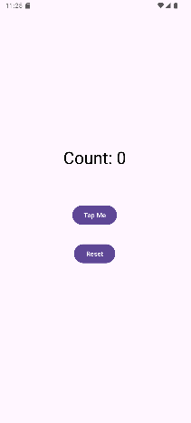

# Counter App
## Overview
This is a basic counter app for an introduction to Android development.

##  Requirements
- [x] TextView in center of the screen displaying "Count: 0"
- [x] Button labeled "Tap Me"
- [x] Increment the count when Button is pressed
- [x] Update TextView with new number

## Stretch Goals
- [x] Add Reset Button to set count to 0
- [x] Change text color when count >= 10
- [x] Preserve count on screen rotation (onSaveInstanceState)

## App UI

